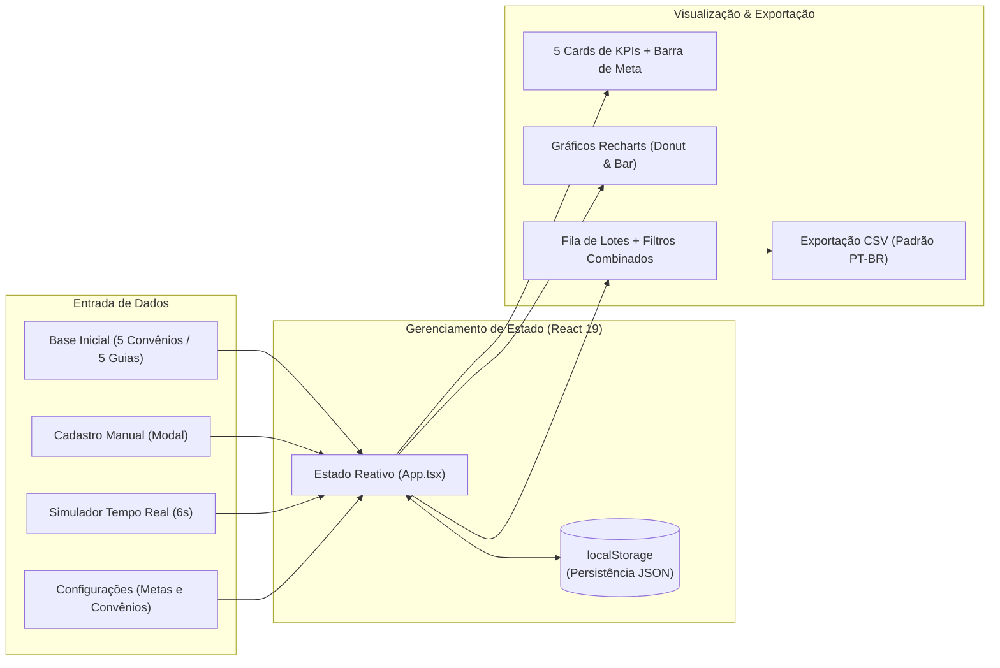

# 📊 Gwaan Analytics — Monitoramento de Faturamento Hospitalar


**Gwaan Analytics** é um dashboard executivo e operacional voltado ao **monitoramento de faturamento médico-hospitalar, controle de guias/lotes (SADT, Internação, Oncologia), gestão de auditoria e retenção de glosas** junto a operadoras de saúde e convênios.

O projeto foi desenvolvido com foco em **usabilidade analítica, identidade visual HealthTech (*Sage & Olive*), visualização de dados em tempo real e persistência local resiliente**, simulando o fluxo financeiro de uma central de faturamento de saúde.

---

## ✨ Principais Funcionalidades

- **📈 5 KPIs Financeiros em Tempo Real + Progresso de Meta**
  - **Contas para Faturar**: Montante financeiro e contagem de guias prontas para envio.
  - **Receita Faturada**: Total aprovado acompanhado de **barra de progresso dinâmica** indicando o percentual atingido da meta financeira.
  - **Em Auditoria / Pendente**: Valores aguardando liberação ou regularização.
  - **Valor Glosado / Retido**: Montante retido que exige recurso ou correção.
  - **Volume Total Processado**: Soma global e contagem de lotes armazenados na base.
- **📊 Gráficos Analíticos Interativos (`Recharts`)**
  - **Distribuição Financeira por Status**: Gráfico de rosca (*Donut Chart*) detalhando a proporção de valores entre `Faturar`, `Faturado`, `Auditoria`, `Pendencia` e `Glosado`.
  - **Volume por Convênio vs. Meta**: Gráfico de barras comparando o volume acumulado de cada operadora/cliente com uma linha de referência (`ReferenceLine`) da **Meta Financeira** configurável.
- **🗂️ Base Inicial Realista Pré-carregada**
  - Inicia com **5 convênios padrão** (*Bradesco Saúde*, *Unimed*, *SulAmérica Saúde*, *Amil* e *Particular*) e **5 lotes iniciais** distribuídos entre todos os status operacionais para visualização imediata dos indicadores.
- **⚡ Simulador de Stream em Tempo Real ("Live Mode")**
  - Motor de simulação ativável com um clique que gera novas guias e lotes aleatórios a cada **6 segundos**, permitindo testar e demonstrar a reatividade dos gráficos e indicadores em tempo real.
- **⚙️ Gestão Completa de Guias, Lotes e Operadoras (CRUD)**
  - Cadastro manual de lotes/guias com seleção obrigatória de operadora, valor financeiro, status inicial e nível de prioridade (`Alta`, `Média`, `Baixa`).
  - Ações rápidas na fila de processamento (**Faturar**, **Auditar** pendências e **Excluir** registros) com carimbo de horário da última atualização.
  - Painel de configurações para cadastrar/remover **Convênios e Operadoras** e ajustar a **Meta Financeira** global.
- **🔍 Filtros Combinados e Exportação para Excel (CSV)**
  - Busca textual instantânea por código (`FAT-XXXX`), operadora ou descrição do lote, combinada com filtros de **Status** e **Prioridade**.
  - Exportação da visão filtrada para arquivo `.csv` formatado para o padrão brasileiro (codificação **UTF-8 com BOM**, delimitador `;` e casas decimais com vírgula).
- **💾 Persistência Automática (`localStorage`)**
  - Todas as demandas, convênios cadastrados e metas são sincronizados automaticamente no navegador, com opção de **Restaurar Padrão** a qualquer momento.

---

## 🎨 Identidade Visual & Design System (*Sage & Olive*)

A interface utiliza uma paleta orgânica inspirada no setor de saúde suplementar (*HealthTech*), priorizando conforto visual e contraste de leitura:

| Token CSS | Cor (Hex) | Aplicação na Interface |
| :--- | :---: | :--- |
| `--palette-lightest` | `#F1F3E0` | Fundo principal da aplicação e campos de formulário |
| `--palette-light` | `#D2DCB6` | Bordas de cartões, estados de *hover*, trilho de progresso e badges |
| `--palette-medium` | `#A1BC98` | Destaques secundários, contornos ativos e séries de gráficos |
| `--palette-dark` | `#778873` | Cor primária da marca, logo/favicon, botões de ação e barras de volume |
| `--text-primary` | `#2C352B` | Tipografia principal de alto contraste |

---

## 🏗️ Arquitetura e Fluxo de Dados



---

## 🛠️ Tecnologias Utilizadas

| Tecnologia | Versão | Finalidade no Projeto |
| :--- | :---: | :--- |
| **React** | `^19.3.1` | Construção da interface reativa e gerenciamento de estado com Hooks (`useState`, `useEffect`). |
| **TypeScript** | `~7.0.2` | Tipagem estática de entidades financeiras (`DemandaFinanceira`, `StatusFaturamento`, `PrioridadeDemanda`). |
| **Vite** | `^8.3.5` | Bundler de alta performance e servidor de desenvolvimento com HMR. |
| **Recharts** | `^3.10.1` | Renderização de gráficos responsivos (`PieChart`, `BarChart`, `ReferenceLine`, `Tooltip`). |
| **Lucide React** | `^1.67.0` | Biblioteca de ícones vetoriais leves para indicadores de status, navegação e ações. |
| **Oxlint** | `^1.89.0` | Linter ultrarrápido para verificação estática de boas práticas em React e TypeScript. |
| **CSS3 Custom Properties** | — | Design System autoral (*Sage & Olive*), layout responsivo em CSS Grid/Flexbox e modais com *backdrop-filter*. |

---

## 📂 Estrutura do Projeto

```text
gwaan-analytics/
├── public/
│   ├── imagens/
│   │   └── profile.jpg          # Avatar do autor exibido no cabeçalho (com link para o LinkedIn)
│   └── favicon.svg              # Logo e Favicon vetorial exclusivo nas cores da paleta
├── src/
│   ├── data/
│   │   └── dadosFaturamento.ts  # Contratos TypeScript e base inicial (5 convênios e 5 guias)
│   ├── App.tsx                  # Componente principal: lógica de negócio, 5 KPIs, gráficos, tabela e modais
│   ├── index.css                # Design System (paleta Sage & Olive, grid responsivo, barra de meta e badges)
│   └── main.tsx                 # Ponto de entrada da aplicação React
├── .oxlintrc.json               # Configuração de regras de lint (Oxlint)
├── index.html                   # Template HTML principal (PT-BR)
├── package.json                 # Dependências e scripts NPM
├── tsconfig.json                # Configurações do compilador TypeScript
└── vite.config.ts               # Configuração do Vite
```

---

## 🚀 Como Executar o Projeto Localmente

### Pré-requisitos
- **Node.js** (versão 20+ recomendada)
- **npm** (ou gerenciador compatível)

### Passo a passo

1. **Clone o repositório:**
   ```bash
   git clone https://github.com/luizpimentel/gwaan-analytics.git
   cd gwaan-analytics
   ```

2. **Instale as dependências:**
   ```bash
   npm install
   ```

3. **Inicie o servidor de desenvolvimento:**
   ```bash
   npm run dev
   ```
   Acesse no navegador o endereço exibido no terminal (por padrão `http://localhost:5173`).

4. **Scripts adicionais disponíveis:**
   ```bash
   npm run lint      # Executa a análise estática de código com Oxlint
   npm run build     # Compila o TypeScript e gera o bundle otimizado de produção na pasta dist/
   npm run preview   # Visualiza localmente a versão compilada de produção
   ```

---

## 👨‍💻 Autor

Desenvolvido por **Luiz Felipe** — Analista de Sistemas.

- 💼 **LinkedIn**: [linkedin.com/in/luiz-felipe-de-almeida-pimentel](https://www.linkedin.com/in/luiz-felipe-de-almeida-pimentel/)
- 🔗 **Repositório**: [github.com/luizpimentel/gwaan-analytics](https://github.com/luizpimentel/gwaan-analytics)
